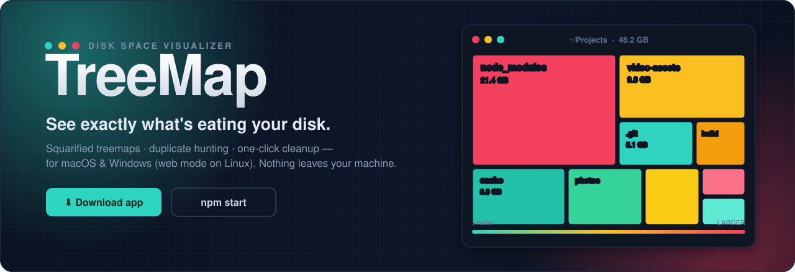
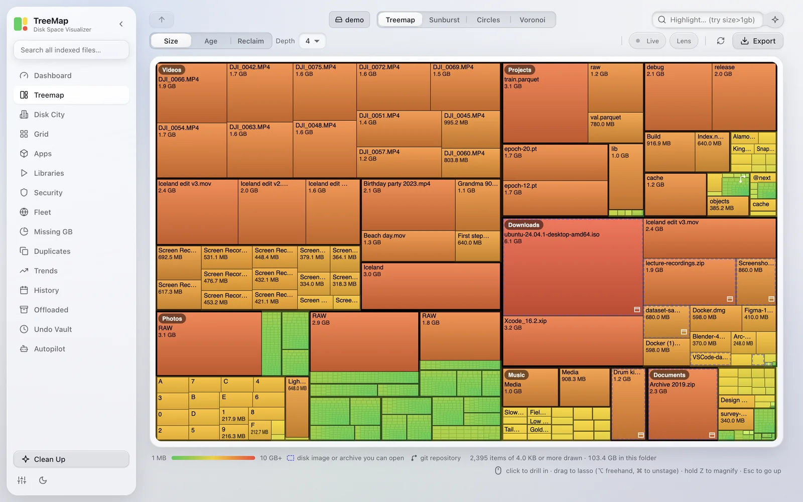
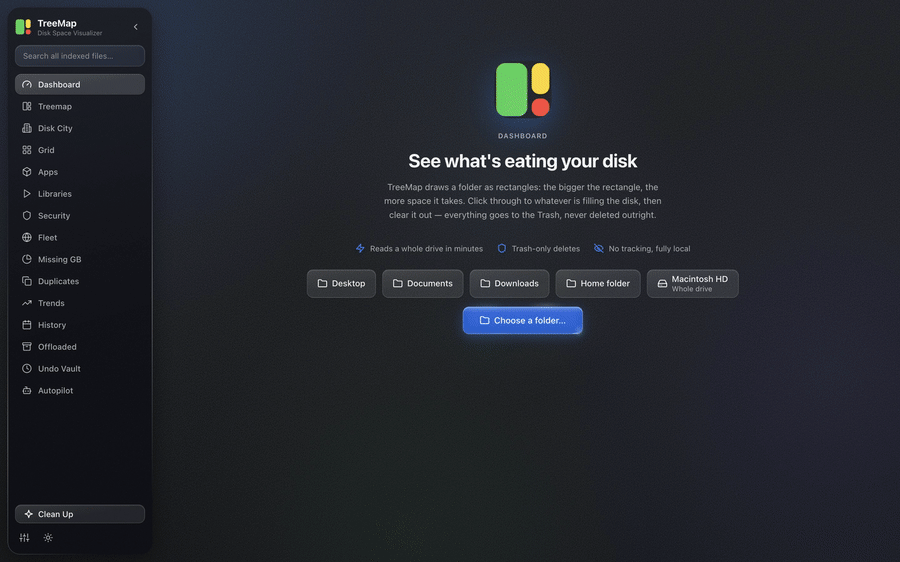
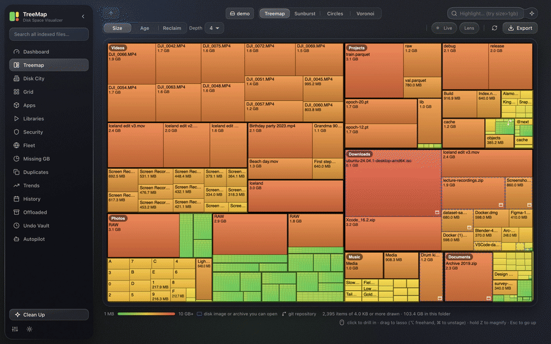
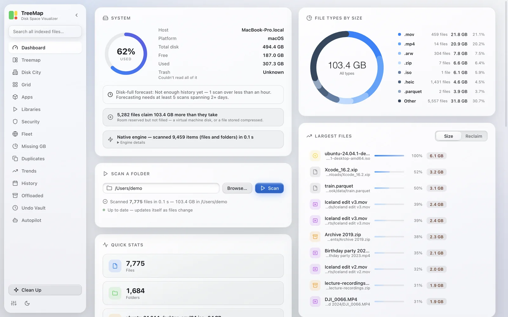
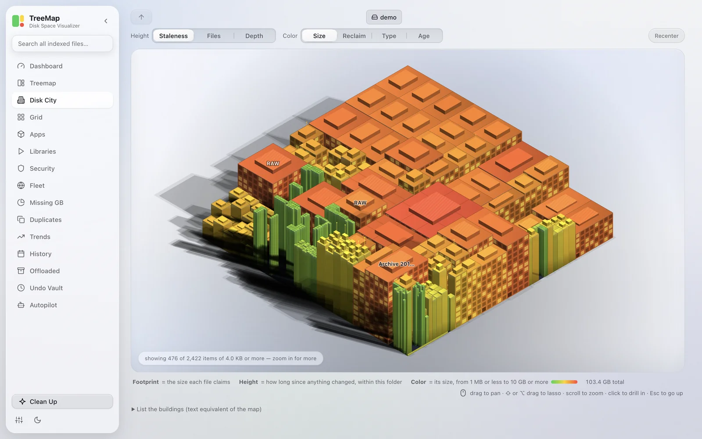
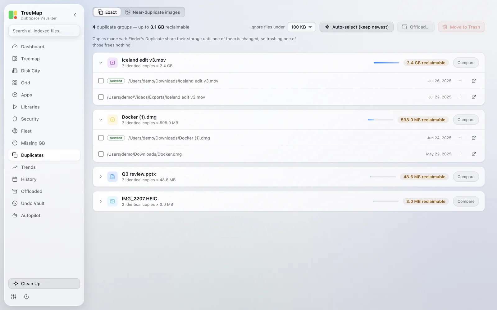
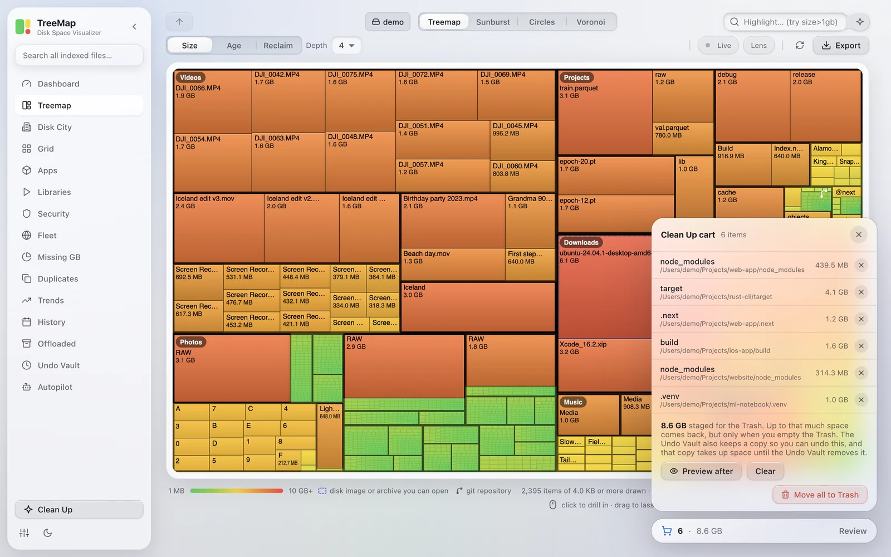
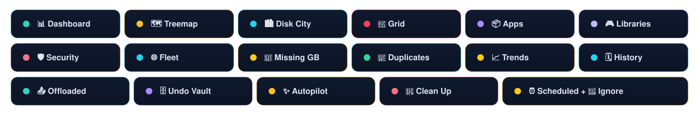

<!-- ░░░░░░░░░░░░░░░░░░░░░░░░░░░  TREEMAP  ░░░░░░░░░░░░░░░░░░░░░░░░░░░ -->

<div align="center">

<a href="https://github.com/Prithvi-Web/TreeMap-Disk-Visualizer/releases">
  
</a>

<br><br>

<!-- primary CTAs -->
<a href="https://github.com/Prithvi-Web/TreeMap-Disk-Visualizer/releases"></a>&nbsp;
<a href="https://github.com/Prithvi-Web/TreeMap-Disk-Visualizer/stargazers"></a>&nbsp;
<a href="https://github.com/Prithvi-Web/TreeMap-Disk-Visualizer/fork"></a>

<br><br>

<!-- platform -->


<br><br>

<kbd><a href="#-download-the-app-for-users">⬇ Download</a></kbd> &nbsp;
<kbd><a href="#-the-seventeen-views">✨ Features</a></kbd> &nbsp;
<kbd><a href="#-inside-vs-code">🧩 VS Code</a></kbd> &nbsp;
<kbd><a href="#-run-from-source--web-mode-3-commands">🚀 Run it</a></kbd> &nbsp;
<kbd><a href="#-use-it-with-ai-mcp">🤖 AI / MCP</a></kbd> &nbsp;
<kbd><a href="#-safety">🛡️ Safety</a></kbd>

</div>


<br>

<div align="center">
<table>
<tr>
<td align="center" width="33%">🟩&nbsp;&nbsp;<b>Find it</b><br><sub>Squarified treemap of every byte</sub></td>
<td align="center" width="33%">🟨&nbsp;&nbsp;<b>Understand it</b><br><sub>Trends, diffs & duplicate hunting</sub></td>
<td align="center" width="33%">🟥&nbsp;&nbsp;<b>Reclaim it</b><br><sub>One-click cleanup → system Trash</sub></td>
</tr>
</table>
</div>

> [!TIP]
> **No Node. No setup. No telemetry.** The desktop app is fully self-contained and scans the disk
> of the machine it runs on. Deletes always go to your **system Trash**, nothing is ever
> hard-deleted, and anything moved there can be put back until the Trash is emptied.

<br>

<div align="center">

<picture><source media="(prefers-color-scheme: dark)" srcset="docs/media/treemap-dark.webp"></picture>

<sub>Screenshots follow your GitHub theme: switch between light and dark to see both.</sub>

</div>

<br>

<table>
<tr>
<td width="50%" align="center"><br><sub><b>Scan</b>: pick a folder, watch it fill in</sub></td>
<td width="50%" align="center"><br><sub><b>Drill in</b>: one folder per click, and back up</sub></td>
</tr>
<tr>
<td width="50%" align="center"><picture><source media="(prefers-color-scheme: dark)" srcset="docs/media/dashboard-dark.webp"></picture><br><sub><b>Dashboard</b>: the whole picture at a glance</sub></td>
<td width="50%" align="center"><picture><source media="(prefers-color-scheme: dark)" srcset="docs/media/disk-city-dark.webp"></picture><br><sub><b>Disk City</b>: footprint is bytes, height is staleness</sub></td>
</tr>
<tr>
<td width="50%" align="center"><picture><source media="(prefers-color-scheme: dark)" srcset="docs/media/duplicates-dark.webp"></picture><br><sub><b>Duplicates</b>: identical files, the copy to keep marked</sub></td>
<td width="50%" align="center"><picture><source media="(prefers-color-scheme: dark)" srcset="docs/media/cleanup-cart-dark.webp"></picture><br><sub><b>Clean Up</b>: stage it, preview it, then move it to the Trash</sub></td>
</tr>
</table>

<br>

## ✨ The seventeen views

TreeMap isn't just a treemap, it's a full disk-hygiene workbench. Press **⌘K** (Ctrl+K) to jump anywhere. Sizes are decimal, as Finder counts them (1 GB = 1,000,000,000 bytes).

<div align="center">
  
</div>

| View | What it does |
|---|---|
| 📊 **Dashboard** | Disk ring, file types, the largest files and folders, a disk-full forecast, Cost to keep, Drive health and folder budget gauges |
| 🗺️ **Treemap** | Every file sized by its bytes. Drill in, search, lasso into the cart, scrub a time slider, watch live changes, look inside archives. Also draws as Sunburst, Circles or Voronoi |
| 🏙️ **Disk City** | The same layout as an isometric city: footprint is bytes, height is staleness |
| 🔲 **Grid** | A size-proportional icon grid, sortable by size, date or Reclaim score |
| 📦 **Apps** | How much disk each app owns: app, caches, data and logs, with a safe cache clear |
| 🎮 **Libraries** | Steam, Epic, GOG, itch.io and media libraries; only the parts that regenerate are offered |
| 🛡️ **Security** | Keys and credentials outside the folder they belong in, found by name and location only |
| 🌐 **Fleet** | How full your other computers are, over your network. Off by default, summaries only |
| 🥧 **Missing GB** | Why "used" and the files you can see don't add up, as a receipt that balances or names the gap |
| 🧬 **Duplicates** | True duplicates by SHA-256, near-duplicate images, and a side-by-side Compare |
| 📈 **Trends** | Every scan charted over time: what grew, what shrank |
| 🗓️ **History** | A calendar of bytes written per day, a journal of big changes, and a diff of any two scans of a folder |
| 📤 **Offloaded** | Files moved to another drive: copied, verified byte for byte, then the originals trashed |
| 🗄️ **Undo Vault** | A verified copy of what the Clean Up cart and Autopilot trash, kept 30 days by default, or less to stay under its size cap |
| ✨ **Autopilot** | Clean Up rules that keep running, with a mandatory first preview and byte caps |
| 🧹 **Clean Up** | Smart suggestions, custom rules, a Reclaim score that explains itself, and a cart that dry-runs before anything moves |
| ⏰ **Scheduled + Ignore** | Rescans on a schedule with growth alerts, and a list of paths and globs to skip |

📖 **Every view in detail, and the limits each one states: [docs/FEATURES.md](docs/FEATURES.md)**

> **How it's built**: Node.js + **Express 5** + **TypeScript**, with a Rust scan core. The frontend is a single, **zero-dependency** `index.html`, generated from `src/ui/`, with hand-coded **Canvas 2D**. Ships as a **web app** _and_ a downloadable **Electron desktop app** for macOS and Windows.


## ⬇️ Download the app (for users)

Grab the latest installer from the [**Releases page**](https://github.com/Prithvi-Web/TreeMap-Disk-Visualizer/releases):

<table>
<tr><th>Platform</th><th>File</th><th>How</th></tr>
<tr>
<td>🍎 <b>macOS</b><br><sub>Apple Silicon only</sub></td>
<td><code>TreeMap-x.y.z-arm64.dmg</code></td>
<td>Open it, drag TreeMap into Applications, then follow <b><a href="#-first-launch-on-macos--apple-could-not-verify">First launch on macOS</a></b>, because macOS blocks it the first time.</td>
</tr>
<tr>
<td>🪟 <b>Windows</b></td>
<td><code>TreeMap-Setup-x.y.z.exe</code></td>
<td>Run it. At the blue SmartScreen prompt click <b>More info</b> → <b>Run anyway</b>, then follow the installer.</td>
</tr>
</table>

> [!NOTE]
> **Intel Mac?** The macOS build is Apple Silicon only: any M-series Mac (late 2020 onward). Not sure? **About This Mac** says either *Apple M…* or *Intel*.
> On an Intel Mac, run TreeMap in web mode (three commands, [below](#-run-from-source--web-mode-3-commands)): it is the same app in a browser tab.
>
> **Linux**, no desktop download: use web mode too, or build your own AppImage with `npm run dist:linux`.

Every release also carries a **portable** Windows `TreeMap-x.y.z.exe` (no installer, keeps its data beside itself).

**Which version do I have?** In the desktop app: **TreeMap → About TreeMap** on macOS, **Help → About TreeMap** on Windows. In web mode, open <http://127.0.0.1:4280/api/capabilities> (or the `PORT` you set) and read `version`; that is the number on the Releases page.

<a id="-first-launch-on-macos--apple-could-not-verify"></a>

### 🍎 First launch on macOS: "Apple could not verify…"

The first time you open TreeMap, macOS says *"TreeMap.app" Not Opened. Apple could not verify…*

**Your download is fine.** macOS shows that for *any* app that isn't **notarized**, and notarizing
needs a paid Apple Developer membership this free, open-source project doesn't have. Every byte is
[public in this repo](https://github.com/Prithvi-Web/TreeMap-Disk-Visualizer), and every release is
built in the open by [GitHub Actions](.github/workflows/release.yml). Get past it **once** with either
route below; after that TreeMap opens normally.

<details open>
<summary><b>Route 1, clicks only, no Terminal</b> (Apple's own way)</summary>

<br>

> ⚠️ ***Right-click → Open* no longer works.** Apple removed that shortcut in macOS **Sequoia (15)**.
> And the **Open Anyway** button in step 3 only shows for about an hour after the block: if it's gone,
> double-click TreeMap again, then go straight back to System Settings.

1. Double-click **TreeMap** in Applications. When the message appears, click **Done**.
2. Open  **System Settings → Privacy & Security** and scroll to **Security** at the bottom.
3. Next to *"TreeMap.app" was blocked to protect your Mac*, click **Open Anyway**, and authenticate.
4. Double-click **TreeMap** again, click **Open Anyway** on the last prompt, and authenticate once more.

</details>

<details>
<summary><b>Route 2, one line in Terminal</b> (fastest)</summary>

<br>

With TreeMap in **Applications**, open **Terminal** (⌘-Space, type `Terminal`) and paste:

```bash
xattr -dr com.apple.quarantine /Applications/TreeMap.app
```

Nothing prints when it works; double-click TreeMap and it opens. This removes macOS's "came from the
internet" marker from TreeMap only. It changes no setting, weakens nothing else, and needs no password.

</details>

<details>
<summary><b>macOS says "TreeMap is damaged and can't be opened" instead?</b></summary>

<br>

Same cause, use **Route 2**. If it still says *damaged* after that, the download was truncated:
delete the `.dmg` and download it again.

</details>

<details>
<summary><b>On macOS Sonoma (14) or older?</b></summary>

<br>

Both routes work, and so does the classic shortcut Apple removed in Sequoia: **right-click** TreeMap → **Open** → **Open**.

</details>

### 🪟 First launch on Windows: "Windows protected your PC"

The installer isn't signed with a paid Microsoft certificate, so SmartScreen shows a blue box once.
Click **More info**, then **Run anyway**.

### 🖥️ Desktop extras

- 📌 **Tray icon** with live free space; close the window and scheduled scans keep running.
- 🖱️ **Drag & drop** a folder onto the window to scan it, or use **"Scan with TreeMap"** from the right-click menu (add it in Settings).
- 🔄 **Auto-updates** from GitHub Releases. Windows downloads and asks before restarting; macOS can't install into an un-notarized app, so it checks and offers a **Download** dialog that opens the Releases page.
- 🧳 **Portable, no-trace mode**: run it from a USB stick and it writes nothing to the host machine.
- ⚙️ **Scanning budget** (Eco, Balanced, Turbo or Automatic) and engine choice, in Settings.


## 🧩 Inside VS Code

The extension in [`vscode-extension/`](vscode-extension/) runs TreeMap's own server and shows the
visualizer in an editor tab.

```bash
cd vscode-extension
npm install && npm run compile
npx @vscode/vsce package --no-dependencies   # produces a .vsix you can install
```

Then **Extensions → ⋯ → Install from VSIX…**, and run **TreeMap: Open Disk Visualizer** from the
command palette, or right-click a folder in the Explorer for **TreeMap: Scan This Workspace Folder**.

The first open clones and builds TreeMap under one cancellable progress notification (if the open
folder *is* this repository, your working tree is used as is). The server runs as a child process on
your own **Node 20+**, never inside the extension host, because its native modules need standard Node.

## 🚀 Run from source / web mode (3 commands)

```bash
npm install
npm run build
npm start
```

Then open **http://127.0.0.1:4280** in your browser. For development with auto-reload: `npm run dev`.

Requires **Node.js 20+**. Trash support uses `gio` on Linux (preinstalled on GNOME/KDE), Finder on macOS, and the Recycle Bin on Windows. A copy run from source scans with the built-in walker (or, on macOS and Linux, gdu, if `npm run fetch:gdu:dev` fetched one or it is on your PATH); to build the faster native engine, install Rust from https://rustup.rs and run `npm run build:native`.

### 📦 Build the desktop app

```bash
npm install
npm run app          # build + launch the desktop app locally
npm run dist:mac     # produce a macOS .dmg in release/
npm run dist:win     # produce a Windows installer in release/
```

> ⚠️ Build the macOS app on a Mac and the Windows app on Windows. Packaging needs **Rust** ([rustup.rs](https://rustup.rs)); installing or running TreeMap never does.

To publish a release for both platforms from GitHub Actions, follow [docs/RELEASING.md](docs/RELEASING.md).


## 🤖 Use it with AI (MCP)

TreeMap speaks the **Model Context Protocol (MCP)**, so AI assistants like **Claude** can use it as a tool. Connect it once and *talk to your disk*:

> *"What's eating my disk?"* &nbsp;·&nbsp; *"Find duplicates in my Downloads and clean them up"* &nbsp;·&nbsp; *"How long until this disk is full?"*

Every safety rule still applies: deletes only go to the system Trash, destructive actions can be dry-run first, and everything is written to an audit log.

### Step 1: One-time setup (~2 minutes)

You need [Node.js 20+](https://nodejs.org). In a terminal:

```bash
git clone https://github.com/Prithvi-Web/TreeMap-Disk-Visualizer.git
cd TreeMap-Disk-Visualizer
npm install
npm run build
pwd
```

The last line prints the folder's full path: use it wherever you see `/PATH/TO/TreeMap-Disk-Visualizer` below.

### Step 2: Connect your AI app

<details>
<summary><b>🟠 Claude Desktop</b></summary>

<br>

1. Open Claude Desktop → **Settings → Developer → Edit Config**. That opens `claude_desktop_config.json`
   (macOS: `~/Library/Application Support/Claude/`, Windows: `%APPDATA%\Claude\`).
2. Add TreeMap to it (if the file already has an `mcpServers` block, just add the `"treemap"` entry inside it):

```json
{
  "mcpServers": {
    "treemap": {
      "command": "node",
      "args": ["/PATH/TO/TreeMap-Disk-Visualizer/dist/mcp/index.js"]
    }
  }
}
```

3. **Fully quit and reopen Claude Desktop.** TreeMap's tools are listed under `treemap`.

> 🪟 **Windows:** write the path with double backslashes, e.g. `"C:\\Users\\you\\TreeMap-Disk-Visualizer\\dist\\mcp\\index.js"`.

</details>

<details>
<summary><b>⌨️ Claude Code</b></summary>

<br>

```bash
claude mcp add treemap -- node /PATH/TO/TreeMap-Disk-Visualizer/dist/mcp/index.js
```

Next session, ask Claude Code to scan a folder. (`claude mcp list` shows it; `claude mcp remove treemap` undoes it.)

</details>

<details>
<summary><b>🖱️ Cursor</b></summary>

<br>

Create (or edit) `.cursor/mcp.json` in your home folder for all projects, or in a project's root for just that project:

```json
{
  "mcpServers": {
    "treemap": {
      "command": "node",
      "args": ["/PATH/TO/TreeMap-Disk-Visualizer/dist/mcp/index.js"]
    }
  }
}
```

Then enable it under **Settings → MCP**.

</details>

<details>
<summary><b>🧩 Any other MCP client</b></summary>

<br>

TreeMap is a standard **stdio** MCP server: command `node`, argument `/PATH/TO/TreeMap-Disk-Visualizer/dist/mcp/index.js`. No environment variables, ports or API keys. (Smoke test from the repo folder: `npm run mcp` should print `server ready on stdio`.)

</details>

### What the AI can do

| Tool | What it does |
|---|---|
| `scan_path` | Scan a folder → returns a `scanId` the other tools use |
| `get_largest` | The biggest files or folders in a scan |
| `reclaim_ranked` | Entries ranked by **Reclaim score**, safest to delete first, with the breakdown |
| `find_duplicates` | True duplicates (size + SHA-256 content hashing) |
| `cleanup_suggestions` | Known-reclaimable space: caches, regenerable build folders, junk |
| `forecast` | Disk-full projection: *"full in ~58 days at current growth"* |
| `missing_gigabytes` | Where the used space went, line by line; an unknown is `null` with its reason, never `0` |
| `compare_scans` | What grew and what shrank between two scans |
| `offload` | Move files to another drive: copy → verify → then trash originals |
| `trash_paths` | Move files to the system Trash, never a hard delete |

The AI can only touch paths **inside folders it has scanned**; `trash_paths` and `offload` accept `dryRun: true` to show the plan first; an `agent-policy.json` can limit it further; and every destructive request lands in an append-only `audit.jsonl`. [AGENTS.md](AGENTS.md) is the full guide.

## 🔌 API

Prefer plain HTTP? Everything is a local REST API (`npm start`, then `/api/*`). Every endpoint is in [docs/API.md](docs/API.md); the machine-readable spec is at `/api/openapi.json`.


## 🛡️ Safety

Disk tools should never lose your data. TreeMap is built defensively:

- ♻️ Deletes always go through the OS Trash: undo from Finder or Explorer until the Trash is emptied.
- 🎯 Trash and open only accept paths **inside a folder you scanned**, never paths inside an archive.
- 🔒 Paths are sanitized; system folders (`/proc`, `/sys`, `/dev`, `/run`, `C:\Windows\System32`, …) are blocked, but not `/run/media`, where Linux mounts a person's own drives.
- 📤 Offload copies, verifies every byte with SHA-256, and only then trashes the originals; a failure before every copy verifies rolls back.
- 🧬 Duplicates always keeps at least one copy, and never opens an online-only file (that would download it).
- ☁️ Cloud scanning is opt-in and metadata-only, and cloud deletes go to the provider's own trash; with no account connected, no cloud code runs.
- 🚦 Per-client rate limiting (10 requests/s for the API, bursts of 20) and graceful shutdown.
- ⏳ Scan results live in memory only and expire after 30 minutes; what's saved stays in the app-data folder on your machine. [SECURITY.md](SECURITY.md) lists every file and every outbound connection.

## 🗂️ Contributing

[CONTRIBUTING.md](CONTRIBUTING.md) has the three commands and the one rule. [docs/ARCHITECTURE.md](docs/ARCHITECTURE.md) has the project layout and the design decisions behind it.

## 📜 Licence

MIT, see [LICENSE](LICENSE). The desktop app also bundles gdu, the native scan core's Rust crates, Electron and Chromium, each with its licence inside the app; [docs/ARCHITECTURE.md](docs/ARCHITECTURE.md#-third-party-licences) says where.

<br>


<div align="center">

### Found this useful?

<a href="https://github.com/Prithvi-Web/TreeMap-Disk-Visualizer/stargazers"></a>&nbsp;
<a href="https://github.com/Prithvi-Web/TreeMap-Disk-Visualizer/fork"></a>&nbsp;
<a href="https://github.com/Prithvi-Web/TreeMap-Disk-Visualizer/issues"></a>

<br><br>

**TreeMap** &nbsp;·&nbsp; built with 🟩🟨🟥 by [**Prithvi-Web**](https://github.com/Prithvi-Web)

<sub>If TreeMap freed up a few gigs for you, a ⭐ goes a long way.</sub>

</div>
