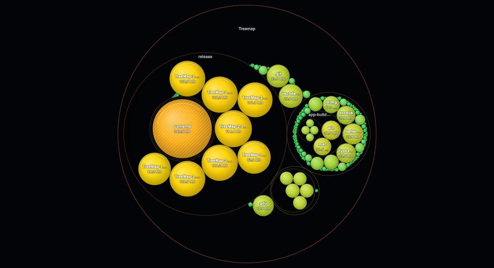
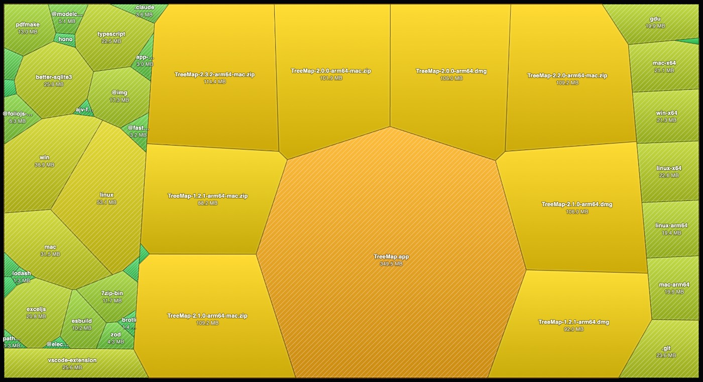
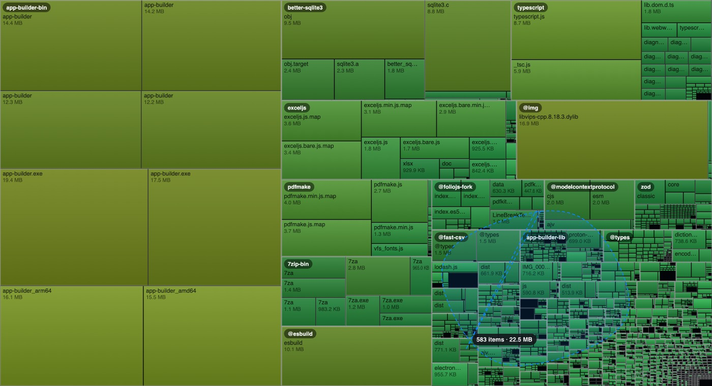
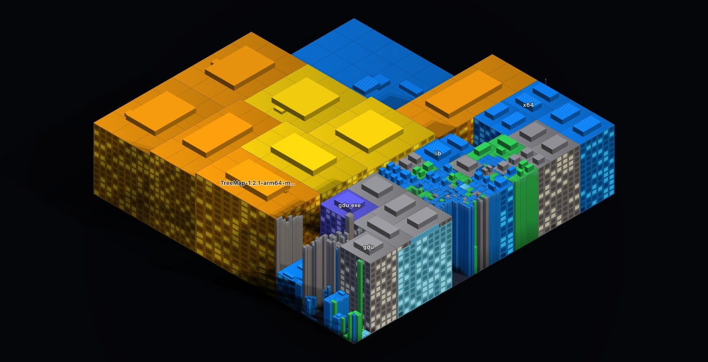

# TreeMap's views, in full

The [README](../README.md) has the short tour. This page is every view in detail: what it does, how it does it, and the limits it states rather than hides.

**Getting around:** **⌘K** (Ctrl+K) opens a command palette over everything, every view, the Clean Up surface, the deep settings sections (type "weights" and land on the Reclaim sliders), the common actions (scan, rescan, empty the cart, export), your saved views, and the folders you've scanned before; anything it doesn't recognise becomes a file search, and closing it puts focus back exactly where it was. First launch offers a **four-step tour**: pick a folder, learn the map, then up to three quick wins, each one a real Smart suggestion with its size and its reason, staged **only when you click** and committed never; it ends at the cart with everything still undeleted. Skippable at every step, and it never returns once finished (Settings has a "show it again" button; a read-only portable session persists nothing, so it honestly forgets).

**Sizes are decimal**, as Finder counts them: 1 KB = 1,000 bytes, 1 MB = 1,000,000 bytes, 1 GB = 1,000,000,000 bytes, on screen, in exports and reports, in the API's and the MCP tools' formatted strings, in every box where you type a size (budgets, Autopilot limits, the Clean Up target), and in the search box (`size>500mb` is 500,000,000 bytes; `kib`, `mib` and `gib` are there for the 1,024-based units). Windows Explorer divides by 1,024 under the same labels, so it shows the same files smaller, by about 7% at gigabyte sizes.

## 📊 Dashboard
Disk-usage ring, live scan progress, file-type donut chart, and the **top-10 largest files _and folders_**. Click a folder to leap straight into the treemap. A **disk-full forecast** projects from your scan history, *"At current growth (+5.4 GB/day), this disk is full in ~58 days, top culprits: …"*, and is honest when it can't know: too little history, erratic growth, or shrinking usage all say so instead of inventing a number. An **All storage** strip unifies your local disk with any connected **Google Drive / Dropbox / OneDrive**, scan a cloud account into the very same treemap (**metadata only, no file contents are ever downloaded**; deletes go to the provider's own trash; duplicates/live/offload are disabled with clear notices). Opt-in and local-first: with no account connected, zero cloud code runs and nothing touches the network.

Two more cards sit here. **Cost to keep** prices the scanned data against Google Drive, Dropbox, OneDrive and iCloud+, in your choice of six currencies, from a table that **ships inside the app**: TreeMap never looks prices up online, so the `as of` date is always on screen and a saving is only claimed when clearing space would actually move you down a **tier**. **Drive health** reports the drive's own SMART attributes and self-assessment **verbatim** and answers one question, which runs out first, free space or write endurance, without ever editorialising; a false *"your drive is dying"* is a real harm, so where the numbers aren't there (no `smartctl`, or a drive that reports no wear indicator) it says exactly that instead.

**Folder budgets get gauges.** Every pinned budget shows a thermometer here, used against limit, coloured by proximity, and, once the folder has enough scan history, *the projected date it breaches its ceiling*. The projection is the disk-full forecast's own code with the budget's headroom standing in for free space (`src/services/budgetGauges.ts` reuses `computeForecast` verbatim), so its refusals are the same ones: too little history, erratic growth, or a shrinking folder all say so under the bar instead of inventing a date. A projection read from shallow snapshot history says that too, on hover.

**Held-up space** catches the disk's most confusing lie: a file you deleted whose space never came back, because a still-running program is holding the handle open. TreeMap groups those by the process holding them, biggest holder first, and offers to ask that process to quit, **gracefully only**. It refuses programs that are part of the operating system (anything run from macOS's `/System`, `/usr`, `/bin` or `/sbin`, Linux's `/usr`, `/bin`, `/sbin` or `/lib`), programs run by the system administrator or another user, TreeMap itself and TreeMap's parent (none of those is even offered a Restart button), refuses a PID whose process isn't what the caller named, and a program that declines to quit is reported as *still running* rather than force-killed. It sees only the programs running under your account (every program when TreeMap runs as root), and an open file it cannot check, or a program of yours whose open files it cannot read, is **counted and said, never claimed** either way, except on Linux under a `/proc` mounted with `hidepid=2`, where such a program is not listed at all, so nothing counts it.

## 🗺️ Treemap
A squarified treemap of every file, sized by bytes and colored **teal → amber → red**, or by **Reclaim score**, which colors each cell by how safe and worthwhile it is to delete rather than how big it is (grey for anything TreeMap could not score, named in the legend rather than left to look like a low score). Drill in, climb back with breadcrumbs + zoom-out, search with highlights (`report`, `*.zip`), pin **folder budgets** (over-budget folders get a red dashed border), and **export** the chart (PNG / SVG), the whole scan (**CSV**, or a multi-page **PDF report**), or the folder's history as an **animated GIF** (dependency-free, hand-written LZW, encoded off the main thread) or a **WebM video** where the runtime can record a canvas, the menu says which you're getting. A **time slider** appears once a folder has scan history: scrub to any past scan and watch the map morph, in the treemap *and* the sunburst, with a **diff overlay** tinting what grew green and what shrank red, and **transport controls** (play/pause, ½×–4×, loop) that play the history as a film: rectangles grow, shrink, bloom in and vanish exactly as the bytes did, while the label steps snapshot by snapshot because an interpolated byte total would be an invented number. And a **Live toggle** watches the scanned folder in real time: changed files pulse, regions re-flow as bytes move, and a "writing now" feed ranks the busiest paths by MB/min (auto-pauses when the disk goes quiet). **Containers are drillable**: .zip/.jar/.tar/.tar.gz/.iso (and Docker's data file, with the CLI) get a badge, click to look inside without extracting a byte, using the archive's own directory listing. Nothing inside an archive can be trashed or opened, only the archive itself. Right-click any file for **where it came from**, the site a download originated at, read from the OS's own quarantine and "where from" metadata. Only the **host** is shown until you click to reveal the full URL, it is written with `textContent` and never as HTML, no clickable link is ever built from it, and TreeMap never fetches it: a URL out of a downloaded file is untrusted input, and it is treated that way. A **drive dock** sits under the map (and under Disk City) whenever external drives are connected, each showing its free space: **drag the cart onto a drive** to offload: the exact manifest and a confirm first, then copy → verify every byte back → only then Trash the originals; a drive that vanishes mid-drag aborts cleanly, and a failure before every copy verifies rolls back completely (an original that cannot go to the Trash afterwards stays beside its verified copy).

**Four ways to draw the same tree.** A segmented control switches between the squarified **Treemap**, a radial **Sunburst**, nested **Circles** and a **Voronoi** map: same folder, same breadcrumbs, same depth, same colour mode, same highlight box. Circle packing sizes every circle so its *area* is its bytes, exactly as the rectangles do, and animates the zoom when you drill so you can see where you went; a folder's name sits on its own ring rather than through its contents. The Voronoi map solves for cells whose areas are proportional to bytes, a weighted centroidal diagram, iterated until no cell is more than 2% off its true share, and when a folder's sizes are too lopsided for that to be reachable in the time a frame allows, it **says so under the map**, with the worst cell's error, instead of presenting an approximation as exact. Anything too small to draw at the current size is counted and named there too. Both solvers lay out under the same wall clock, so a folder with thousands of near-identical children cannot hang a frame, when one runs out of time it stops subdividing and says that under the map, rather than quietly drawing less.

**Drag to lasso.** Rubber-band by default, freehand with ⌥, and everything whose centre falls inside is staged in the Clean Up cart, with a running count and byte total while you drag, so you can see what you have caught before you let go. ⌘ (Ctrl) over a region takes those items back out. Nothing is deleted and no gesture ever empties the cart; the cart still runs its own dry run and confirmation. It works the same way in **Disk City**, where a modifier is needed because a plain drag pans.

**Hold `Z` to magnify.** A circular lens at 4× over the parts of the map where tiles are two pixels wide, redrawn from the layout rather than scaled up from the picture, so the edges stay crisp and the names are legible at a size they were never drawn at. There is a **Lens** button for pinning it.

**Ask in plain words.** The ✨ button beside the highlight box turns *"big videos I haven't opened in a year"* into `size>1gb ext:mp4,… used>1y`, and the translation is **always shown in an editable field before it runs**, because a natural-language box that hides what it actually searched is a black box, and this one is a query builder with a friendlier front door. The phrase table is built in and works **entirely offline**, unknown words are listed as ignored, never silently dropped, and a test statically proves the whole feature contains zero network code.

**Notes pinned to folders.** Right-click any folder (or press `n` on the keyboard selection) and write yourself a note: *"client archive, keep until 2027"*. The note shows in the tooltip and as a small sticky-note glyph on the tile, and it means something to the machine too: by default a noted folder and everything inside it is **excluded from Smart suggestions and every Autopilot match**, and Autopilot's previews and run records say what was left alone and why. The pause is per-note toggleable, notes are rendered as plain text only (never HTML), and deleting one re-arms automation, which is why the notes endpoints sit in the app's pinned destructive list.

**Human-scale sizes.** Next to folders over about 1 GB the tooltip can add *"≈ 3,100 photos or 48 videos like the ones here, based on the 2,847 photos in this folder, average 12.1 MB"*. The comparison always comes from the folder's **own** photos, videos or music (at least ten of a kind), never from a made-up average, the master rule is in `src/services/facts/humanScaleProvider.ts`, which also explains why there is no "hours of video" figure: that would need a bitrate constant, and the same sentence that demands honesty forbids one. Folders with nothing comparable show nothing. Toggle in Settings, on by default.

## 🏙️ Disk City
The Treemap's own tiling, seen from a corner, the *same* arrangement, not a similar one, so switching between them is legible rather than disorienting. A flat treemap encodes exactly one variable in area; this encodes three at once. **Footprint** is bytes, **height** is staleness (or file count, or nesting depth), **colour** is size, on the Treemap's own ramp (or Reclaim score, file kind, or age). *"The tall red tower is a 40 GB thing you have not opened in two years"* reads instantly in a way a red rectangle never does.

Pure Canvas 2D: an isometric projection is a 2D affine transform, and there is no WebGL, no 3D engine and no dependency anywhere in it. The draw order is a topological sort rather than a depth number, because **no per-box number can order a real treemap layout correctly**, that was measured against a ray-casting oracle, and four plausible scalar keys each got dozens of pairs wrong. Buildings are lit from one named direction, cast shadows onto the roofs behind them, and are finished with parapets, rooftop plant and the occasional mast; none of that carries data, which is why it is drawn at low contrast and never near a label.

Drag to pan, scroll to zoom, click to go inside, Escape to come back out. Height is normalised to the folder you are standing in, and the legend says so. A block that swallowed its children is hatched rather than presented as a thing with nothing inside it, and the level-of-detail line always names its own threshold, *"showing 4,120 of 251,000 items"*, because a map that quietly drew a fraction of what it was given is lying by omission. Everything on it is also listed as a **text equivalent** below the map, in draw order.

## 🔲 Grid
A size-proportional icon grid with multi-select, sorting, and virtual scrolling, buttery even on huge folders. Sort by name, date, last accessed, type, size, or by **Reclaim score**, which answers *what is safest to delete* rather than *what is biggest*. Anything TreeMap could not score sorts last rather than as zero.

## 📦 Apps
**How much disk does each application own?** Every app's total, split into **app / caches / data / logs**, with a **"Clear caches safely"** button (Trash-only, never touches your data) and click-through into the treemap. Files no app owns land in an honest "Everything else" bucket, so the totals always match the scan.

## 🎮 Libraries: games & media
Steam, Epic, GOG and itch.io libraries, read from each launcher's own manifests (including a hand-written parser for Valve's KeyValues format), with **Steam's own reported size shown next to TreeMap's** so you can see they agree. Every title is split into **base install / shader cache / workshop content / Proton prefix / DLC**, and **only the shader cache is ever offered for removal**, because it regenerates at the cost of one stutter on next launch. The rest costs a redownload, a mod re-subscribe, or a destroyed compatibility prefix, so TreeMap won't put a checkbox next to it.

The same deal for **media libraries**: Photos, Final Cut Pro, iMovie, Lightroom and Capture One bundles, read from each app's **own documented layout**, never guessed directory names. Each splits into **originals / derivatives / database**, and **only derivatives are ever offered** (renders, proxies, thumbnails, previews), each stating the cost of regenerating it: *"Photos will rebuild thumbnails on next open; expect a slow first launch."* Originals never get a checkbox: the file **is** the data. A library whose layout isn't recognised shows its size and offers nothing, and a library its app is holding open says so and offers nothing.

## 🛡️ Security
Finds **keys, credentials and wallets sitting outside the folder they belong in**, a private key in `~/Downloads`, an `id_rsa` on the Desktop, a `.env` in a shared folder. It matches on **name and location only: no file is ever opened, and no file content is ever read, stored or shown**. There is **no delete button at all**. The single remedy offered is *Move to `.ssh`* (or the appropriate home), which is a **rename**, both ends must sit inside a folder you scanned, an occupied destination aborts the move, and nothing is ever removed. Findings never leave this machine, and are explicitly excluded from anything the Fleet view can share.

## 🌐 Fleet: other machines on your network
See how full your *other* computers are without walking over to them. **Off by default**, and it announces nothing until you turn it on. Machines exchange a **summary only**, the name you gave the machine and its OS, the volume's total/used/free, and the folder you last scanned with its time and size. That list is not a promise in a README, it's an **eleven-field allow-list in the code** ([`fleetSummary.ts`](../src/services/fleet/fleetSummary.ts)) that is the only thing ever serialised, with a second check that throws rather than send a field whose name so much as *smells* like a file tree, a security finding or a provenance URL.

**File trees, Security findings and download origins never cross the network, and there is no remote-delete route in the server at all**: not a disabled one, not a permission-gated one; it does not exist. Asking a peer to run a scan is a *separate* opt-in that peer must grant. Pairing is a **six-digit code**, compared in constant time, good for three minutes and one machine; a wrong guess doesn't cancel the window, so nobody on the network can interrupt a pairing by guessing, but guessing is bounded: five wrong codes and that machine is refused, fifty in all and the code is withdrawn and you are told which machine was trying. The LAN listener is a **separate server with three routes**, the main API is never mounted on it and stays bound to `127.0.0.1`, and it binds one of this machine's private IPv4 addresses (the first it finds), never `0.0.0.0`; the Fleet panel names the one it listens on. Discovery is hand-written mDNS over `dgram`, no dependency added.

## 🥧 Missing GB: where the space actually went
The complaint this answers is that **the numbers do not add up**: the Finder says 188 GB used, a disk tool shows 156 GB of files, and nothing explains the difference. This view is one accounting statement for the volume, printed as a receipt, a bar over the disk's whole capacity, then the arithmetic with a rule above the total.

**It balances or it names the gap.** Every line is bytes, the lines sum to the volume's used space *exactly*, and whatever is left over gets its own **Unaccounted** line rather than being folded into the others to look tidy. That is enforced in code, not just tested: [`assertBalances`](../src/services/missingGigabytes.ts) throws on every build of a statement, so a future line that forgets to join the sum fails loudly instead of shipping a receipt wrong by exactly its own size.

The lines are files the scan walked, online-only files counted but not resident, filesystem snapshots, purgeable space, space held by programs still gripping a deleted file, **other volumes sharing the same storage pool**, and what the scan was refused. That sixth line is most of the point on a Mac: Preboot, VM and Update sit in the same APFS container as `/`, share its free space, and no scan of `/` ever walks them, about 12 GB a files-only tool simply loses.

**An unknown is never shown as a zero.** A line that could not be measured says so, in full, with the real reason, and the Unaccounted line names it, so the gap is attributable rather than mysterious. Two on this Mac: **purgeable space**, which macOS reports only through a native API (`diskutil`, `diskutil apfs` and `system_profiler` were each checked and none carries the figure, and TreeMap's native scan core does not ask for it, it lists folders, builds the scan's store and governs the scan), and **what a gdu scan was refused**, because gdu emits a folder it could not open as an ordinary *empty* folder and exits 0. The native engine and the built-in walker count refusals exactly (and so does the NTFS turbo mode on Windows); only they claim a zero.

Also stated rather than implied: hard links are already counted once by the scan, so they are a note under that line and not a second deduction; and copy-on-write clones **cannot** yet be told from real copies, no Node API exposes clone identity, and the native scan core does not ask APFS for it, so where they exist that line is an over-count and the difference lands in Unaccounted. Every remedy offered is a signpost to an existing, separately-gated action, nothing here deletes anything.

## 🧬 Duplicates
Finds **true** duplicates (size + streamed SHA-256), grouped with reclaimable space per group. **Online-only files are never opened**, reading an iCloud, OneDrive or Dropbox placeholder would download it, so they are left unchecked, and the view says how many and how big. Auto-select keeps the newest copy of each. A **Near-duplicate images** tab catches resized, re-encoded and screenshot copies with a perceptual **dHash**. And because bulk-deleting duplicates is the scariest action in the app, every group has a **Compare** view: copies side by side, thumbnail, dimensions, EXIF capture date, size, path, with the recommended keep marked **and the rule that picked it stated**, the differing dHash regions highlighted over near-duplicate pairs ("4 of 64 blocks differ"), and full keyboard control (←/→ groups, 1–9 keeper, Space stages the rest). Facts the disk doesn't record show as exactly that, *"no capture date recorded"*, never a guess.

## 📈 Trends
Every scan saves a lightweight snapshot, charted over time per folder, with a clear **"what grew / what shrank since last scan"** breakdown.

## 🗓️ History: Calendar · Journal · Compare, one view
The whole time dimension lives in **one History tab** with three panels.

**📅 Calendar.** A GitHub-style heatmap of **bytes written per day**: one cell per day, weeks as columns, years stacked. Toggle between **modified** (exact, from the scan itself) and **created** (per-file stats behind a cap, with any unread days reported honestly rather than drawn as empty). Hover for a day's total and file count; **click a day, or drag across a range, and the treemap filters to those files**, through the same query grammar as the search box, so the result is exactly what typing `modified:2026-03-14` would show.

**📓 Journal.** A rolling, human-readable narrative of significant changes, *"**Tuesday 18 March**, Docker added 14.2 GB (`~/Library/Containers/com.docker.docker`)"*, built by scheduled scans from snapshot deltas, capped and rotated in `journal.jsonl`. **Attribution never guesses**: an app is named only when the path provably belongs to it, "**you**" only when TreeMap's own audit log matches the deletion, and otherwise the entry says exactly *"an unidentified process."* Each entry links back into the treemap at that path and day. Portable sessions keep the journal in memory only and say so, nothing is written to the host.

**🔀 Compare.** Pick any two scans of the same folder for a file-level diff: **added, removed, grew, shrank.** History pairs also get a **split-slider**: both snapshots rendered as treemaps in one canvas with a draggable divider revealing one over the other, photo-comparison style, fully keyboard-accessible (the divider is a native slider: arrows nudge it, Home/End snap, and its position is announced to screen readers). Subtrees collapse to one row instead of thousands. Every **removed** row also offers **"Check snapshots"**, your OS has probably been keeping filesystem snapshots (APFS local snapshots, Btrfs subvolumes, Volume Shadow Copies) the whole time, so a file deleted weeks ago and long gone from the Trash is often still recoverable. Looking costs nothing and asks for nothing; recovering asks for your administrator password once, at that moment, on macOS and Windows (Linux needs none). The recovered copy is written **beside** the original, never over whatever is there now, it came from an older snapshot, so overwriting by default would replace newer work with older.

## 🧹 Clean Up
**Custom rules** (old / huge / by extension / duplicated), **Smart suggestions**, sorted into **regenerable** (`node_modules`, Rust/Maven `target`, virtualenvs, build output, each shown with the command that restores it), **cache**, and **junk**, plus a per-profile **browser cache** breakdown (Chrome / Edge / Brave / Firefox / Safari), and **Empty folders**. Everything → Trash.

**Reclaim Score** ranks by how safe *and* how worthwhile something is to delete, out of 100, from six signals TreeMap already has: how big it is (against this scan's own distribution, not a fixed threshold), how long since it was last opened, whether a rule pack says it rebuilds itself, whether an identical copy exists on this disk, whether it was downloaded, and whether a copy exists elsewhere (a pushed Git remote, a sync client, a backup). Every score is one click from its breakdown, what each signal contributed, in a sentence, and **what could not be computed**.

That last part is the design. A signal TreeMap cannot read is **left out of the score and named**, never counted as zero: a file with no download record is not *less* redownloadable than one that was downloaded, it is *unknown*, and scoring it as zero would rank a file nobody can vouch for below one positively known to be worthless. Missing signals lower a confidence band instead, and the panel shows how much of the score was actually measured. Where last-opened dates are unavailable, the last-*changed* date stands in, stated in the sentence you read, and costing the score a confidence step, because a caveat nothing acts on is decoration.

The weights live in **Settings → Reclaim Score** and are yours to change, with a reset to the defaults. A ranking whose reasoning you cannot inspect or adjust is an oracle, and this app does not ship oracles. Setting a weight to zero removes that signal from the score entirely, which is a different statement from it scoring zero. And the score never selects anything: it sorts, and it explains.

**The Clean Up cart** is the one place a deletion is actually committed. Stage anything, from any view that lists something reclaimable: Largest files, Duplicates and near-duplicates, Clean Up groups and rules, Empty folders, package orphans, browser caches, cloud-only files, an app's **caches and logs** (never the app itself or your data), a game's **shader cache** (never the install, the mods or a Proton prefix), or every file a query matched. Advisory groups and Security findings get no cart button at all, not a disabled one, none, because they have no delete path anywhere in the app.

**Preview after** re-lays the treemap out with the staged items taken out and hatches what would come back, under a banner that says nothing has been deleted. The freed space stays on the map rather than the survivors growing into it: area means bytes, and a rectangle that silently became worth more bytes than it was a second ago would make every size comparison against the live map wrong. Exiting restores the map exactly as it was. It is pure arithmetic in the browser, no scan, no server call, nothing on disk.

Committing runs a **dry run first, always**: the exact manifest, every path with its size, and anything that will be **left in place** with the reason. Then the whole batch goes through the **Undo Vault** as one run, copied, verified, and only then trashed, so **Undo this run** puts every file back at its original path, even after you have emptied the Trash, until the Undo Vault removes its copies (after 30 days by default, or sooner to stay under its size cap). Anything too large for the Undo Vault to protect is **left undeleted rather than deleted unprotected**, said in the manifest before you click rather than in a summary afterwards. Undo puts files back byte for byte while the Undo Vault holds their copies, **with their permissions and the dates they were last modified and opened**, including a folder's own, restored after its contents so that writing the children back does not re-stamp it. (Not the date each was created: no system lets a program set that back.)

An optional **Clean Up target** in Settings, "free 50 GB", gives the cart a meter filling toward it. A meter, and nothing else: no streaks, no badges, no confetti. A progress meter is information; a reward loop pointed at deleting your own files is manipulation.

Smart suggestions come from **versioned rule packs** ([`src/services/rulepacks/`](../src/services/rulepacks/)) rather than hard-coded logic, so adding a known offender is a JSON edit. Every group has a **“why is this suggested”** panel showing what matched, how confident the rule is, and how to put it back. A few of the biggest things on a disk, a Docker/WSL virtual disk, Windows.old, root-owned package caches, are listed **for their size only, with no delete option**, because the file *is* the data or the OS owns it; those show the supported way to reclaim the space instead.

**Shrink video** re-encodes large videos to HEVC using the Mac's **hardware encoder** (VideoToolbox through `ffmpeg`, never a software encode that would run for hours). It is not offered on Windows or Linux yet: TreeMap cannot yet confirm a hardware HEVC encoder there, and the panel says so. This is the one lossy thing TreeMap does, so the order is the guarantee: encode beside the original → probe the result → verify it → *only then* trash the original → rename → restore timestamps. If any step before the Trash step fails, the original is still sitting there untouched; if the rename after it fails, the original is in the Trash and the new file beside where it was, and the result says where both are. Right before the Trash step TreeMap checks whether a program holds the original open, and one it sees open keeps its original (that file's re-encoded copy is discarded). The check cannot see every program, on a Mac, not one another account runs, and where it cannot run, the Trash step goes ahead. One file's problem never stops the rest of the batch. Where `ffmpeg` isn't installed the panel says so plainly and offers nothing.

**Package orphans** sorts package-manager artifacts into **orphaned** (no project file such as `package.json` beside them, though a folder of scripts may still use them; a virtualenv's interpreter is gone, so it cannot run; or a Homebrew keg is superseded by a newer linked one, each says which), **active** (context only) and **shared cache** (always reclaimable), each with the command that restores or clears it. It **refuses to guess**: with the owning manifest missing, a directory is only claimed when one of the rule's `evidence` children is actually present, an unidentifiable folder is reported as nothing rather than as garbage.

## 📤 Offloaded
The third option next to *keep* and *trash*: **Offload…** copies files to another drive, **verifies every byte** (SHA-256, read back from the destination), and only then moves the originals to the Trash, never a bare move; a failure before every copy verifies rolls back cleanly, and an original that cannot go to the Trash afterwards stays beside its verified copy. This tab is the searchable index of everything offloaded, with per-destination totals, reveal-on-destination, and verified **Restore**. Unplugged drives show grayed out with a last-seen date.

## 🗄️ Undo Vault
The safety net for **Autopilot** and the **Clean Up cart**. Before either moves anything to the Trash, TreeMap copies it here, **verifies every byte** (SHA-256), and only then moves the original to the Trash, so emptying the Trash doesn't lose it, as long as the copy is kept. Searchable and grouped by run, with one-click verified **Restore** back to the exact original path (never overwriting anything that's there now). It can't fill your disk: a size cap (by default 10% of the free space on its disk, counting what it already holds) evicts the oldest copies first, and anything too big to protect is **left undeleted rather than deleted unprotected**, with the reason shown, never hidden in a log. Copies are kept 30 days by default; both numbers are in Settings. Files you move to the Trash any other way (right-click, the Grid, Duplicates, Clean Up) go to the Trash as usual and aren't copied here.

## ✨ Autopilot
**Clean Up, but it keeps happening.** Write a policy once, *"clear old build folders in ~/Projects"*, and TreeMap carries it out on its own. Every rail §B1 asks for is here and visible in the editor: **the first run of any new policy is always a preview**, showing exactly what it matched, and it deletes nothing until you approve it; **byte caps** per run and per rolling week; a **cooldown** that doubles as the schedule; and *"ask me first above N GB"* so a policy that suddenly matches far more than expected **stops instead of executing**. Everything it removes goes through the Undo Vault first, so **a run can be undone in one click** until the Undo Vault removes its copies (after 30 days by default, or sooner to stay under its size cap), and the run history shows what each run deleted *and why*, or the reason it decided not to. Clean Up stays exactly as it was: manual, for deleting something right now.

A policy can also match a **query**, the same search language as the treemap box, so a saved view becomes a Clean Up rule and a Clean Up rule becomes a policy, with one matching engine the whole way up. The query is checked by that same parser before the policy can be saved, and one with no conditions is refused outright: it would select every file in the folder, unattended. Promotion pre-fills the editor and saves nothing, the policy that comes out still starts switched off, still previews every run, and still cannot delete anything until you have seen its first run and approved it.

## ⏰ Scheduled scans + 🚫 Ignore list
Re-scan folders on a schedule with **growth-threshold alerts** and **disk-full forecast warnings** (native desktop notifications; the forecast horizon is configurable in Settings, default 30 days). A scan that came due while TreeMap was closed runs about 10 minutes after it opens, never the moment it opens. Tell it what to skip with paths, names, or globs like `*.iso` and `~/projects/**/dist`.

## 🖥️ Desktop extras

- 📌 **Menu bar / tray icon** with live free-disk stats and quick actions (open app, scan home folder, quit). Close the window and TreeMap stays in the tray so scheduled scans keep running, quit from the tray menu.
- 🖱️ **Drag & drop** a folder onto the window or dock icon to scan it instantly.
- 🔄 **Auto-updates** from GitHub Releases, checked shortly after launch and every 6 hours. Windows downloads the new version and asks before restarting. macOS cannot install an update into an un-notarized app, so there TreeMap only *checks* and offers a **Download** dialog that opens the Releases page, drag the new build into Applications yourself. Decline once with "Skip this version" and that version stays quiet.
- 🔔 **Growth alerts** from scheduled scans arrive as native notifications.
- 🖱️ **"Scan with TreeMap" in the right-click menu**, a Finder Quick Action on macOS, a shell entry on Windows, and a Nautilus / Dolphin / Thunar entry on Linux (for a build you made yourself). Add or remove it from Settings in the desktop app, the entry starts the installed app, so a browser tab or a build run from source does not offer to add it (one already there is shown with the program it starts, and can be removed); it applies to **your account only and needs no administrator rights**. TreeMap asks the OS whether it's installed every single time rather than remembering, so uninstalling TreeMap can never leave a dead menu entry behind claiming otherwise.
- 🧳 **Portable, no-trace mode**, run TreeMap from a USB stick and it writes **nothing to the host machine**: settings, index and history all live beside the executable. If the medium is read-only it goes fully **ephemeral**, memory-backed storage, an in-memory database, an audit ring buffer, and the Undo Vault switched off *with the reason shown* rather than silently, and the same when the `TreeMap-Data` folder beside it is a link or holds one, since whoever prepared the drive could have pointed TreeMap's saves elsewhere. Portable builds: `npm run dist:portable-mac` / `-win` / `-linux`.
- ⚙️ **How hard a scan works is yours to set.** Settings › Scanning budget: Eco (about a quarter of the computer), Balanced (about half), Turbo (up to nine-tenths), or Automatic: Turbo for a scan you start and watch, Balanced for the ones that run on their own, a step lower on battery, and Eco when the system reports serious heat. Settings › Scan engine picks the engine, Automatic, the native engine, gdu or the built-in walker, and on Windows offers the opt-in **NTFS turbo** mode, which reads a drive's file table directly with administrator permission, after asking, for TreeMap installed for everyone who uses the computer. The Dashboard says which engine and budget every scan used, and why.

## 🛡️ Safety, in full

Disk tools should never lose your data. TreeMap is built defensively:

- 🔒 Paths are sanitized and traversal-proofed; system dirs (`/proc`, `/sys`, `/dev`, `/run`, `C:\Windows\System32`, …) are blocked outright, but not `/run/media`, where Linux mounts a person's own drives.
- 🎯 Trash/open endpoints only accept paths **inside a folder you scanned**, and never paths *inside an archive* (only the archive itself can be trashed).
- ♻️ Deletes always go through the OS Trash, undo from Finder/Explorer until the Trash is emptied.
- 🪟 On Windows, a path Windows would rewrite before binning it (a name ending in a dot or a space) is left alone, with a sentence saying why, never a different file in the Recycle Bin.
- 📤 Offload never bare-moves: copy first, verify every byte against a SHA-256 read back from the destination, and only then trash the originals, a failure before every copy verifies rolls back with local data untouched, and an original that cannot go to the Trash afterwards stays beside its verified copy.
- ☁️ Cloud scanning is strictly opt-in and metadata-only: no file contents are ever downloaded, OAuth tokens live only in the local app-data folder (Disconnect wipes them), cloud deletes go to the provider's own trash, and with no account connected no cloud code path executes at all.
- 🧬 The Duplicates view refuses to trash *every* copy in a group, at least one always stays.
- 🧬 The duplicate finder never opens an online-only file (an iCloud, OneDrive or Dropbox placeholder): reading one would download it. It says how many it left unchecked instead.
- 🚦 Token-bucket rate limiting per client IP, in three lanes priced by what a request costs the server, 10 requests/s sustained (bursts of 20) for the API, 150/s (300) for thumbnails, 60/s (120) for cheap metadata, plus graceful SIGTERM shutdown that drains live SSE streams and stops background hashing, scheduled scans & live-activity watchers.
- ⏳ Scan results live in memory only and auto-expire after 30 minutes. What does reach disk, history snapshots, settings, the SQLite live index, Undo Vault copies, the offload catalog, the journal and the audit log, sits in the platform app-data folder (`~/Library/Application Support/TreeMap`, `%APPDATA%\TreeMap`, or `~/.config/treemap`) and never leaves the machine. [SECURITY.md](../SECURITY.md) lists every file, and every outbound connection the app can make.
